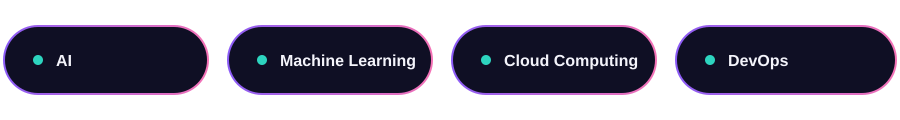

<!-- ===================== HERO ===================== -->
<p align="center">
  
</p>

<p align="center">
  <a href="https://github.com/codeninjavik">
    
  </a>
</p>

<p align="center">
  
</p>

<p align="center">
  
  
  
</p>

---

## 👨‍💻 About Me


I'm a **Full-Stack Developer** and **AI/ML enthusiast** who enjoys turning ideas into clean, scalable and useful products.

```yaml
name:         Vikash Kumar
role:         Full-Stack Developer · AI/ML Enthusiast
working_on:   Web & AI projects
asks_about:   [Web Development, Python, Open Source]
fun_fact:     Late-night coding sessions & gaming marathons 🎮
open_to:      Collaborations · Open Source · Knowledge sharing
```

> 💡 *"First, solve the problem. Then, write the code."*

<br clear="right" />

---

## 🌱 Currently Learning

<p align="center">
  
</p>

---

## 🛠️ Tech Stack

<p align="center">
  <br/>
  
</p>

| 🌐 Frontend | ⚙️ Backend | 🧠 AI / Data | 🧰 Tools |
|:--|:--|:--|:--|
| HTML · CSS · JavaScript | Node.js · Express | Python | Git · GitHub |
| TypeScript · React | Django · PHP | Machine Learning | Linux · VS Code |
| Tailwind · Bootstrap | MySQL · MongoDB | Deep Learning (learning) | Figma · Android Studio |

---

## 🚀 Featured Projects

<p align="center">
  <a href="https://github.com/codeninjavik/MYRA-AI-ASSISTANT-"></a>
  <a href="https://github.com/codeninjavik/lia-build-guide"></a>
</p>
<p align="center">
  <a href="https://github.com/codeninjavik/myra-install-guide"></a>
  <a href="https://github.com/codeninjavik/ai-bot-"></a>
</p>

---

## 📊 GitHub Analytics

<p align="center">
  
  
</p>

<p align="center">
  
</p>

<p align="center">
  
</p>

<!-- Snake animation: uncomment after adding snake workflow (see SETUP.md)
<p align="center">
  
</p>
-->

---

## 🏆 Achievements

<p align="center">
  
</p>

---

## 🤝 Let's Build Something Together

<p align="center"><i>Collaboration, open source ya koi idea ho to message karein.</i></p>

<p align="center">
  <a href="mailto:vikashkumar132280@gmail.com"></a>
  <a href="https://www.linkedin.com/in/vikash-kumar-kushwaha-a6435a335"></a>
  <a href="https://youtube.com/@codeninjavik"></a>
  <a href="https://www.instagram.com/codeninjavik"></a>
  <a href="https://t.me/gyaanRepo"></a>
  <a href="https://www.facebook.com/share/1WTRRNqFGr/"></a>
</p>

<!-- ===================== FOOTER ===================== -->
<p align="center">
  
</p>
